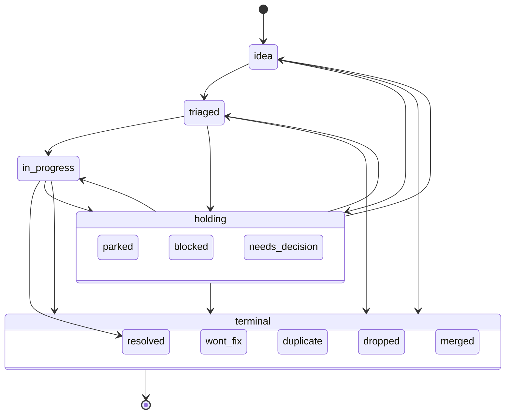

# sea-lite

**A work queue for parallel coding agents that can't collide.**

Run three agents against one backlog and the failure mode is not that they
are slow. It is that two of them pick up the same ticket, both "finish" it,
and the one that finishes second overwrites the first. Or one of them dies
holding a ticket and nobody else ever touches it.

sea-lite is a small MCP server where tickets are **fenced**:

- `sea_next` atomically picks the best eligible ticket **and** claims it. The
  caller gets a one-time **claim token**; every write (`sea_update`,
  `sea_transition`, `sea_link`) must present it. A write from anyone else is
  refused and says who holds the ticket and until when.
- Claims are **leases** (≤ 600 s). An agent that dies stops refreshing; the
  next reader sees the lapsed lease, treats the ticket as free, and records
  that it did. No sweeper, no cron.
- A claim can carry a **scope**: the paths the holder will edit. Two agents'
  live scopes may not overlap (`scope_conflict` names the holder, ticket,
  paths and expiry), and `sea_scope_check` lets an edit hook refuse a write
  inside someone else's scope. The numbers that motivated it: PR pairs from
  different agents conflicted 41.7% of the time, pairs from one agent
  19.8% — agents could lock tickets but not each other's files.
- Tickets carry **typed links** (`depends_on`, `blocks`, `parent_of`, …).
  `sea_next` will not hand out a ticket whose predecessors are still open, and
  the precedence graph is kept acyclic on every write.
- `sea_apply` lays down up to 50 tickets and 100 links in **one all-or-nothing
  write**, so an epic with its children and dependency edges lands as a unit
  or not at all.
- Every change is an event on a **hash chain** — the one
  [kronicle-lite](https://github.com/rafe-walker/kronicle-lite) keeps. The
  same SQLite file holds both. `sea_history` shows a ticket's record and
  whether the chain still verifies; `sea-lite rebuild` replays the tables from
  the chain.

One process, one file, no accounts. Speaks MCP **2026-07-28** (per-request
metadata, `server/discover`, cacheable `tools/list`, `outputSchema` +
`structuredContent` on every tool, multi round-trip confirmation) and still
serves 2025-era clients that open with `initialize` — the same process
answers both. Runs over stdio next to Claude Code, Cursor, Codex, Copilot,
Claude Desktop or any MCP client. Several server processes (one per agent,
or one shared) can point at the same file; SQLite's write lock and
`BEGIN IMMEDIATE` make claims exclusive across processes.

## Install

Requires Node ≥ 20. Data lives in `~/.kronicle-lite/kronicle-lite.db` (or
`--data-dir`, or `$KRONICLE_LITE_DATA_DIR`), shared with kronicle-lite if
you run that too. Give every agent its own `--actor` label: claims and
scopes are held per actor.

### Claude Code

```sh
claude mcp add sea-lite -- npx -y sea-lite serve --actor claude
```

Copy `skills/work-queue/` into `.claude/skills/work-queue/` so the agent
knows the claim → scope → work → release loop, and wire the edit hook from
`hooks/README.md` so an `Edit`/`Write` inside another agent's scope is
blocked before it happens.

### Cursor

`.cursor/mcp.json` in the project (or `~/.cursor/mcp.json` for everywhere):

```json
{
  "mcpServers": {
    "sea-lite": {
      "type": "stdio",
      "command": "npx",
      "args": ["-y", "sea-lite", "serve", "--actor", "cursor"],
      "env": { "KRONICLE_LITE_DATA_DIR": "${userHome}/.kronicle-lite" }
    }
  }
}
```

Cursor asks before running MCP tools unless you allowlist them; the
read-only ones (`sea_get`, `sea_list`, `sea_history`, `sea_scope_check`)
are safe to allow. Put `skills/work-queue/SKILL.md` into a project rule so
the agent claims its paths before editing.

### Codex (CLI, IDE extension, app)

`~/.codex/config.toml` (or `.codex/config.toml` in a trusted project):

```toml
[mcp_servers.sea_lite]
command = "npx"
args = ["-y", "sea-lite", "serve", "--actor", "codex"]
env_vars = ["KRONICLE_LITE_DATA_DIR"]
startup_timeout_sec = 20
default_tools_approval_mode = "writes"   # prompt only on write tools

[mcp_servers.sea_lite.tools.sea_transition]
approval_mode = "prompt"                 # terminal states are irreversible
```

Codex reads the server `instructions`; the loop is in them.

### GitHub Copilot coding agent

Repository **Settings → Copilot → MCP servers**, "MCP configuration". The
coding agent runs in a fresh Actions sandbox, so point it at a store the
run can reach, and allowlist tools explicitly: GitHub recommends read-only
tools, and Copilot code review only loads tools whose
`annotations.readOnlyHint` is `true`. Ours that qualify: **`sea_get`,
`sea_list`, `sea_history`, `sea_scope_check`**.

```json
{
  "mcpServers": {
    "sea-lite": {
      "type": "local",
      "command": "npx",
      "args": ["-y", "sea-lite", "serve", "--actor", "copilot", "--data-dir", "/tmp/sea-lite"],
      "env": { "SEA_LITE_ROLE": "agent" },
      "tools": ["sea_get", "sea_list", "sea_history", "sea_scope_check"]
    }
  }
}
```

Once a server is configured Copilot calls its tools without asking, so add
the write tools (`sea_create`, `sea_apply`, `sea_claim`, `sea_next`,
`sea_update`, `sea_transition`, `sea_link`, `sea_refresh`, `sea_release`)
only if you want the agent taking and closing tickets on its own. Secrets
and variables for the `env` block must be named `COPILOT_MCP_*`.

### Any other client

```json
{ "mcpServers": { "sea-lite": { "command": "npx", "args": ["-y", "sea-lite", "serve", "--actor", "me"] } } }
```

A 2026-07-28 client probes with `server/discover`; a 2025 client sends
`initialize`; both are served.

## Sixty-second tour

```sh
# a scratch store
export KRONICLE_LITE_DATA_DIR=/tmp/sea-demo

# the server, as an agent would see it (stdio; Ctrl-D to stop)
npx sea-lite serve --actor me

# look at the queue from a shell
npx sea-lite list
npx sea-lite show 0060ea49
npx sea-lite verify          # recompute every chain hash, exit 1 on mismatch
npx sea-lite rebuild         # drop + replay the sea tables from the chain
```

The agent's loop, in tool calls:

```
sea_next  scope.paths=[src/handlers]   → { ticket, claim_token, expires_at }  (paths locked too)
sea_scope_check paths=[...]            before touching a path you did not claim
sea_update   (notes, tags)             fenced by claim_token
sea_refresh                            if the work runs long (≤ 600 s per refresh)
sea_transition to=resolved confirm     terminal states release the claim and the scope
   — or —
sea_release  note="where I stopped"
```

```sh
npx sea-lite scope-check src/handlers/claims.ts --actor me   # exit 1 if someone else holds it
```

## Tools

| Tool | What it does |
| --- | --- |
| `sea_create` | One ticket (`idea`, or `triaged` to make it dispatchable). Returns `possible_duplicates` (exact + full-text title match) but never blocks. `claim_seconds` claims it in the same call. |
| `sea_apply` | 1–50 tickets + ≤ 100 links between them, all-or-nothing. Rejects duplicate refs, foreign refs, self-loops, duplicate links and cycles with a list of every problem. `dry_run`. |
| `sea_get` | Ticket by id or ≥ 8-char prefix: fields, `row_version`, claim holder/expiry (never the token), active links with peer title/status, notes, `legal_next`. |
| `sea_list` | Filters (status, kind, priority, assignee `me`/`none`, tag, claimed `any`/`yes`/`no`/`mine`), FTS5 `query`, cursor paging, `compact`/`full`. |
| `sea_claim` | Lease one or a set of tickets (all-or-nothing, locked in id order). Returns a token per ticket. Re-claiming your own ticket rotates the token. `scope.paths` locks the paths you will edit for the lease; `scope_conflict` if they overlap another actor's live scope. |
| `sea_refresh` | Extend a lease to now + N (≤ 600); never shortens; holder-only. Not chained. |
| `sea_release` | Holder gives the ticket back (with a hand-off `note`). `force: true` for operators (`--role operator`), recorded as a force release. |
| `sea_update` | Title/body/kind/priority/assignee, tags add/remove, append a note. Fenced; `expected_version` (OCC); `idempotency_key`; `dry_run`. |
| `sea_transition` | Move status. Fenced. Rejections carry `legal_next`. `duplicate` needs `duplicate_of` and records a `duplicates` link. Terminal states release the claim (and scope) and ask for confirmation: `confirm: true`, or answer the `input_required` prompt. |
| `sea_link` | `add` / `remove` a typed link, fenced on `from`. `parent_of` / `depends_on` / `blocks` stay acyclic across existing links. Remove tombstones. |
| `sea_next` | Pick + claim the highest-priority unclaimed `triaged`/`in_progress` ticket assigned to me or unassigned whose predecessors are all terminal. Takes `scope.paths` like `sea_claim`. |
| `sea_history` | Events for one ticket, or a `since_seq` feed of all sea events, with chain verification status. |
| `sea_scope_check` | Read-only: would editing these paths collide with another actor's live scope? `{ ok, conflicts }`. For an edit hook; no claim needed. |

Plus a `sea://tickets/{id}` resource (same shape as `sea_get`).

Every tool publishes an `outputSchema` and returns the same JSON as
`structuredContent` and as text. Every error is `{ error: <code>, message,
details }` with a closed code set (`fence_invalid`, `fence_foreign_holder`,
`fence_expired`, `already_claimed`, `scope_conflict`, `version_conflict`,
`illegal_transition`, `cycle`, `batch_invalid`, `confirmation_required`,
`confirmation_declined`, …) so an agent can branch on it.

## Scopes: locking the files, not just the ticket

A ticket lock stops two agents from doing the same work. It does not stop
them from editing the same file for different tickets — and that is where
most cross-agent merge conflicts come from. So a claim can carry the paths
its holder is going to touch:

```
sea_claim { ticket_ids: [id], scope: { paths: ["src/handlers", "docs/*.md"] } }
```

- An entry without glob characters is a **prefix**: the path and, when it
  is a directory, everything beneath it. `src/handlers/claims.ts` is one
  file; `src/handlers` is the subtree; `next.js/` (trailing slash) says a
  dotted name is a directory. A git worktree or a package directory is a
  natural scope.
- An entry with `* ? [ ] { }` is a **glob** (picomatch): exactly the paths
  it matches. `*` stays inside one segment, `**` crosses. `.` is the whole
  repository.
- Two scopes overlap when any entry of one can name the same file as any
  entry of the other (`src` ↔ `src/**/*.ts`, `docs/x.md` ↔ `docs/*.md`;
  not `src` ↔ `src2`, not `*.ts` ↔ `*.md`). The full rule is in
  `docs/MODEL.md`.
- Overlap with a **different actor's** live, unexpired scope is refused with
  `scope_conflict` listing every holder, ticket, overlapping pair and
  expiry. Your own scopes never conflict with each other.
- The scope lives and dies with the claim: release, a terminal transition,
  or lease expiry frees it. It is on the chain (`sea_ticket.claimed`), so
  `sea-lite rebuild` restores it.
- `sea_scope_check { paths }` is the fast path for a hook: one read, no
  claim. `hooks/README.md` has a Claude Code `PreToolUse` example that
  blocks an edit inside someone else's scope with the holder and expiry in
  the message.

## Lifecycle



Work track moves are one step forward at a time. Any active ticket may enter a
holding state or a terminal state; holding states resume only to `idea`,
`triaged` or `in_progress`; terminals have no exit. An optional design track
(`--tracks work,design`) adds `idea → in_design → ready → in_progress`.

Kinds: `feature research investigation refactor curiosity question other bug
chore incident security epic spike log docs decision`. Priorities: `urgent
high medium low parked` (`parked` is never dispatched by `sea_next`).

Link types: `parent_of relates_to inspired_by responds_to conflicts_with
supersedes blocks depends_on condenses_into branches_from references
duplicates`. Direction reads `from <type> to`.

## Composes with kronicle-lite

sea-lite does not have its own chain. It opens the kronicle-lite store (or
adopts an already-open one) and appends `sea_ticket.*` / `sea_link.*` /
`sea.batch_applied` events to the same hash chain, inside the same
transaction as the row change. That buys you:

- **One `get_system_state`.** An agent that orients with kronicle-lite sees
  ticket creations, status changes and link changes in its delta. Routine
  claim churn (`claimed`, `claim_released`, `claim_expired`) rolls up by
  default so it does not crowd the briefing; a force release is enumerated.
- **Retractions.** A tombstoned link is classified as a safety retraction by
  kronicle-lite's classifier, like a tombstoned block.
- **One verify, one export.** `kronicle-lite verify-chain`, `checkpoint` and
  `export` cover sea events. After `kronicle-lite import`, run
  `sea-lite rebuild` to re-project the tables (import rebuilds documents
  only).
- **Shared idempotency.** `idempotency_key` lands in the chain's unique
  column under a `sea:` prefix; a replay returns the first result.

You can run sea-lite without ever running kronicle-lite's server. The
dependency is the library.

## Limitations (read these)

- **Cooperative fencing.** A claim token stops a well-behaved agent from
  writing a ticket it does not hold. It does not stop a process with the
  SQLite file from editing rows directly. The chain makes that detectable
  (`sea-lite verify`), not impossible.
- **Self-asserted actors.** `--actor` and per-call `actor_id` are labels the
  caller chooses. The "different holder" check is defence in depth against a
  leaked token, not authentication. See `docs/THREAT-MODEL.md`.
- **Lazy expiry.** A lapsed lease is noticed by the next read or write that
  touches the ticket (or by `sea_list` / `sea_next`, which sweep). Nothing
  fires on its own.
- **Local only.** stdio transport, one machine, one file.

## Roadmap

See `ROADMAP.md`. Next up: links from `sea_apply` to existing tickets,
bulk mutate, Streamable HTTP, a read-only board.

## Development

```sh
npm install
npm run build && npm test && npm run lint && npm run typecheck
npm run catalog:check    # tools/list etc. must match .mcp-catalog/sea-lite.json byte for byte
```

The tool catalog is a reviewed artifact: `.mcp-catalog/sea-lite.json` is
the canonical snapshot (via [mcp-catalog-snap](https://github.com/rafe-walker/mcp-catalog-snap))
and CI fails on drift. Changed a description or schema on purpose? Run
`npm run catalog:snapshot` and commit the diff.

## License

Apache-2.0. See `LICENSE` and `NOTICE`.

---

Built off-grid in Cochise County, AZ — https://theexiledentrepreneur.com
